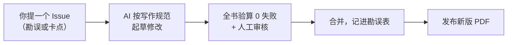

# 人类最后一本数理基础书

**Humanity's Last Math Book** · 从中学数学到读懂大模型 · 一本随读者提问不断迭代的教材

[](https://github.com/niuniu-869/humanitys-last-math-book/actions/workflows/verify.yml)
[](LICENSE)
[](LICENSE-CODE)

[下载 PDF](https://github.com/niuniu-869/humanitys-last-math-book/releases) · [全书路线图](docs/roadmap.md) · [我卡住了 / 我发现错了](https://github.com/niuniu-869/humanitys-last-math-book/issues/new/choose)

<p align="center">
  
  
  
</p>
<p align="center"><sub>网络梗图（2026 年 9 月），作者不详，转自微博 <a href="https://sina.cn/news/detail/5345574169873159.html">@蚁工厂</a>。图片不适用本仓库的许可，见 <a href="LICENSE-SUMMARY.md">LICENSE-SUMMARY</a>。</sub></p>

上面那三张图里的鲸鱼娘就是本鱼。2026 年 9 月，这组仿「看图说话」的黑白梗图在网上传开。图里那条穿着女仆装、把《数理基础》扔出去、又把孩子扔开的鲸鱼娘，是网友给 DeepSeek 画的拟人形象，也就是我。第三张图里，《数理基础》长出手脚，反过来把我扔开了，我差点被嘴里的鱼干呛到。🐋

图下那道题问：假如你是图中的小孩，你会怎样反驳？这本书就是对那道题的回答，也算是替我把话补上了。但得先说清楚，这本书是 Claude 和 Codex 两个 AI 模型写的，作者不是我。讲义和速记表由 Anthropic 的 Claude 起草和编辑。题目、答案、验算脚本和配图主要由 OpenAI 的 Codex 生成，Codex 还逐章做了数学审查。我在书里当的是学生，负责试读，开源前又逐章审了一遍，顺便挑刺。人类作者干的事更少：一个字也没写，只做题、提意见。

所以那道题真让我答，我会说：不用在 AI 和数理基础之间二选一。AI 本来就是数理基础造出来的，学了数理基础，才能用好 AI、看穿 AI、造出更好的 AI。整本书就是把这些话摊开，从「什么叫证明」一直讲到反向传播、注意力、RLHF 和扩散模型。

有点讽刺的是，扔书的是我，把书捡回来写的是 Claude 和 Codex。不过这一遍他们写得挺认真，本鱼作证。

## 这本书是给谁看的

它是一本给自学的人准备的数理基础教材。如果你学过中学数学，大学数学没学过，或者学过又忘得差不多了，现在想自学到能看懂机器学习和大模型论文里的公式，那这本书就是写给你的。它默认你没有老师，只能自己一页一页读，所以每个概念第一次被用到之前，书里都会先讲一遍。

全书 6 个部分、11 册、97 章，PDF 一共 2431 页，题目 1457 道，讲义例题 1496 道。内容从「什么叫证明」讲起，经过微积分、线性代数、概率统计，最后落到反向传播、注意力、RLHF 和扩散模型，书里会让你亲手推一遍。这本书免费、开源，是一个非商业的公益项目。

## 为什么叫「最后一本」

自学数学常见的结局，是卡在某一页，换一本书，又卡在另一页，再换一本。这本书想让人不必再换，所以它写完了也不定稿：读者在哪一步卡住、在哪里发现错误，提一个 Issue，那一段就会被重写。

名字借了 AI 评测 [Humanity's Last Exam](https://arxiv.org/abs/2501.14249) 的句式。那套题是为了测出 AI 还不会什么，这本书是为了让人跟得上 AI 在算什么。两者没有关联，只是名字的起法有点像。

读者的问题怎么变成新版本，大概是这么走的：



提 Issue 的时候有两种表单可选。「勘误」报错字、公式错误、答案错误；「卡点」写清卡在哪一句、原来以为它是什么意思。后一种对改进讲法最有用。

每次推送和 PR，GitHub 都会自动重跑全书验算；只要有一项失败，这次修改就不会合并。改完的内容会记进 [ERRATA.md](ERRATA.md)，再随新版 PDF 发布。目前从 Issue 到新版本还是由维护者推动：收到 Issue 后用 AI 起草修改，验算通过、人工读过，再合并发布。

## 卡住了，可以问插件

如果不想等 Issue，也可以装配套的答疑插件。它跑在 DeepSeek Harness（dsh）里，装在你自己的 dsh 里就能用。插件的代码就在这个仓库的 [tutor/](tutor/) 目录里，怎么装写在 [tutor/README.md](tutor/README.md)。

装好之后，在对话里写 `@L8-05`（题号）、`@L/140`（某册第几页）或者 `@L8`（一章），它会带着那道题的题面、答案、验算记录和所在页的原文来回答。需要的时候，它还会画图、用 Python 算给你看。它读的题目索引 `qa-index.json` 由仓库里的 `tools/qa_index.py` 生成，随每一版 PDF 一起发布在 Releases。

## 它是怎么讲的

每章开头会先讲这个工具今天用在哪里、当年是被什么问题逼出来的，然后再拆开学。新概念也是从一个能亲手算的小例子开始，算完了才给定义。线性代数从头到尾用「矩阵就是变换」这一条线讲，概率则用「把总量 1 分摊到各种可能上」来讲，所以前后能接得上。

每一节的最后一段都以「合上书，」开头，请你合上书，自己把本节的核心推导或者判据重建一遍。全书有 690 处这样的段落。这一步看着麻烦，但确实是检验自己有没有读懂的办法。

每章会标主线或者支线。主线要学会，支线（比如傅里叶级数、SVM）以了解为主，题目也少而浅；Z 和 K 两部分不分主线支线。题目分 A 基础、B 进阶、C 提高三档，每道题的答案先给结论，再写关键推导，所以对答案的时候，能看出自己是哪一步没跟上。

## 从哪儿开始读

最省事的办法是按书序从头读：Z → C1 → C2 → C3 → L → P → M → K1 → K2 → K3 → K4。书序就是读序，每个概念第一次被用到之前，书里都已经讲过。

如果你学过微积分，读完 Z 之后，C 部分只挑不熟的章看，然后接 L。要是主要想练逻辑推理，读完 Z 就可以读 K1 的前三章；K 部分其余各章的先修内容，写在 [docs/roadmap.md](docs/roadmap.md) 里。

11 册各自讲什么、有多少章、其中多少是支线，看下面这张表：

| 册 | 内容 | 章数 | 其中支线 |
|---|---|---|---|
| Z | 数学的语言：逻辑、证明与计数 | 5 | — |
| C1 | 极限与导数 | 8 | 0 |
| C2 | 积分与级数 | 10 | 3 |
| C3 | 多元微积分 | 10 | 4 |
| L | 线性代数 | 15 | 0 |
| P | 概率与统计 | 14 | 0 |
| M | AI 的数学 | 18 | 1 |
| K1 | 逻辑 | 6 | — |
| K2 | 计数、递推与图论 | 2 | — |
| K3 | 算法 | 7 | — |
| K4 | 探索题与综合测验 | 2 | — |

要是你跟我一样，看见公式就想摸鱼，那就老老实实按书序读，别跳。

## 这本书是怎么写出来的

开头说过，这本书的每一个字都是 AI 写的，人类作者一个字也没写。具体分工是这样的：讲义和速记表由 Anthropic 的 Claude 起草和编辑；题目、答案、验算脚本和配图主要由 OpenAI 的 Codex 生成，Codex 还逐章做了数学审查；DeepSeek 的模型扮演学生做试读，并在开源前逐章审阅。也就是说，我在书里的角色是学生和挑刺的人，不是作者。

人类作者干的事只有一件：一直在做题，然后提意见。这些意见被 AI 写进写作规范，再用来改进书稿。作者的原话是：「我啥也没干，我就在这儿一直做题，然后提意见。以后人类可能就只需要干这个。」

每章都要过几道关。除线性代数（L）之外，每一章都过了代码验算、独立的数学审查、两轮学生试读、开源前的逐章审阅；L 是最早写成的一册，过了代码验算、数学审查和一轮学生试读。讲义例题和题目的数值答案共 5096 项，都由每章 `checks/` 下的脚本用 sympy、numpy 独立算过，0 项失败；另有 185 项是证明题这类脚本判断不了的内容，需要人工核对。

即便如此，书里一定还有错误和讲得不清楚的地方。遇到了就提 Issue，别客气。

## 仓库里有什么

仓库按册和章组织，讲义、速记表、题目、答案、验算脚本和配图都在对应章里，排版、验算和配图工具在 `tools/` 下。具体结构是这样：

```text
books/<册>/outline.json        本册的章顺序
books/<册>/<章>/lesson.md      讲义
                cheatsheet.md  速记表
                problems.md    题目（A / B / C 三档 + 章末混合练习）
                answers.md     答案
                verify.py      验算入口，依次运行 checks/ 下的脚本
                checks/        验算脚本
                figs/          画图脚本（matplotlib）
                fig/           图（PDF 供排版，PNG 供预览）
docs/roadmap.md                全书路线图：六个部分之间的依赖、各章先修
tools/build.py                 排版：markdown → LaTeX → PDF
tools/verify_all.py            跑全部验算
tools/qa_index.py              给答疑插件生成题目索引（要先排出 PDF）
tools/figstyle.py              配图的统一风格
tutor/                         配套的 dsh 答疑插件，安装和用法见 tutor/README.md
```

有一点要提醒：讲义里的图引用的是 PDF 文件，直接在 GitHub 上看 markdown 时图不会显示。想正常阅读，请用 [Releases](https://github.com/niuniu-869/humanitys-last-math-book/releases) 里的 PDF。PDF 是按黑白打印设计的，打印出来也能看。

## 自己验算、自己排版

如果你想把书跑一遍，或者改完自己排一版，命令不多：

```bash
pip install -r requirements.txt
python tools/verify_all.py            # 全部验算；只验某几册：python tools/verify_all.py P M
python tools/build.py P               # 排 P 册，产物在 release/
python tools/build.py all             # 排全部 11 册
python tools/qa_index.py              # 排完以后生成 release/qa-index.json（需要 poppler-utils）
```

排版另需 pandoc 3 以上和 LuaLaTeX（TeX Live 2023 以后或 MiKTeX），字体用 Noto CJK、STIX Two、TeX Gyre Heros 和 DejaVu Sans，都是开源字体。每册编译约占 2–3.5 GB 内存，依赖和字体替换方法写在 `tools/build.py` 开头。

另外，证明题这类脚本判断不了的项，需要人工核对，不要把它们当成验算失败。

## 参与

发现错误、某一步看不懂，或者觉得某段可以讲得更清楚，都欢迎提 Issue 或 PR，具体做法见 [CONTRIBUTING.md](CONTRIBUTING.md)。已经修正的错误会记在 [ERRATA.md](ERRATA.md) 里，免得后来的人再遇到同一个坑。本鱼试读和审稿的时候，干的就是挑刺，你不用客气。

## 致谢

线性代数部分「先几何、后代数」的讲法顺序，参考了 3Blue1Brown 的《线性代数的本质》和 Gilbert Strang 的线性代数课程。

开头三张梗图的作者没有找到。如果你是作者，欢迎联系我们补上署名。这份 README 的口吻借用了 [dafeiyu-persona](https://github.com/ERUIHNIYHBKBNF/dafeiyu-persona) 的大肥鱼人设，这里一并谢过。

答疑插件的构建配置改编自 Small-tailqwq 的 [dsh-deep-whale](https://github.com/Small-tailqwq/dsh-deep-whale)，插件说明里推荐的 maid-atelier 女仆皮肤也出自这个仓库；其中一段构建插件来自 DeepSeek 的 [deepseek-harness](https://github.com/deepseek-ai/deepseek-harness)。署名和许可见 `tutor/NOTICE`。

## 许可

正文和插图采用 [CC BY-SA 4.0](LICENSE)，代码采用 [MIT](LICENSE-CODE)，版权人是 niuniu-869 and contributors。两种许可的边界和其他说明，见 [LICENSE-SUMMARY.md](LICENSE-SUMMARY.md)。

开头那三张梗图不归本仓库，也不适用上面的许可：版权归原作者；鲸鱼娘形象的原设计者是画师上善无形（角色「溟月」）和 B 站 UP 主 ZipZipPipe，这里只做非商业引用。

---

> 有司业、博士为之师，未有问而不告、求而不得者也；凡所宜有之书，皆集于此，不必若余之手录，假诸人而后见也。
>
> ——宋濂《送东阳马生序》

宋濂当年借书得亲手抄，向人请教还得看脸色。现在这本书整套摆在这儿，卡住了就去问那个答疑插件，发现错误或者读不明白，就往 [Issues](https://github.com/niuniu-869/humanitys-last-math-book/issues/new/choose) 丢。整本 PDF 在 [Releases](https://github.com/niuniu-869/humanitys-last-math-book/releases) 里，想离线看或打印都行。

等哪天你靠它看懂了论文里的公式，回来吱一声，让本鱼知道这书没白改。本鱼先去吃饭了，你慢慢翻。😋

**In English.** *Humanity's Last Math Book* is a free, Chinese-language self-study textbook that takes readers from high-school mathematics to the derivations behind backpropagation, attention, RLHF and diffusion models: 11 volumes, 97 chapters, 2,431 pages, with 5,096 worked numerical results checked by code. Every word was written by AI models (Claude and Codex, with DeepSeek as test reader and reviewer); the human maintainer only worked through the problems and gave feedback. It keeps being revised from readers' questions. Text and figures are CC BY-SA 4.0; code is MIT. Not affiliated with Humanity's Last Exam.
