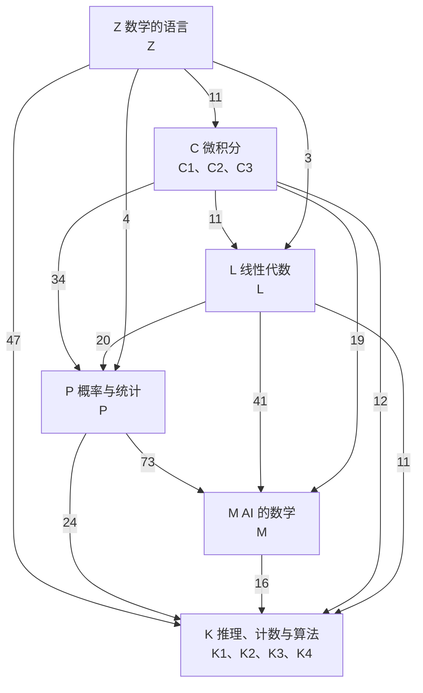

# 全书路线图

全书按「不先用后讲」排：每个定义、定理、技巧，第一次被用到之前都已经讲过。书序是 Z → C → L → P → M → K。
每章标主线或支线，支线以了解为主；Z 和 K 两部分不分主线支线。

## 六个部分之间的引用

箭头从被引用的部分指向引用它的部分，数字是后面部分引用前面部分的节数。

| 部分 | 册 | 一句话主线 | 先修 |
|---|---|---|---|
| Z 数学的语言 | Z | 把中文翻成逻辑式，把推理写成证明，把可能的情形数清楚。 | 无，从这里开始 |
| C 微积分 | C1、C2、C3 | 放大了看都是直线，切细了再加起来。 | 数学的语言（11 处） |
| L 线性代数 | L | 矩阵就是变换。 | 数学的语言（3 处）、微积分（11 处） |
| P 概率与统计 | P | 概率就是把总量 1 分摊到各种可能上。 | 数学的语言（4 处）、微积分（34 处）、线性代数（20 处） |
| M AI 的数学 | M | 每个模型都是同一个三件套：模型、损失、优化。 | 微积分（19 处）、线性代数（41 处）、概率与统计（73 处） |
| K 推理、计数与算法 | K1、K2、K3、K4 | 数学上不深，难在读懂题目里的结构。 | 数学的语言（47 处）、微积分（12 处）、线性代数（11 处）、概率与统计（24 处）、AI 的数学（16 处） |

## 各章先修

「先修」列出读这一章前要先读的章（取自全书的节级目录）。

### Z · 数学的语言：逻辑、证明与计数

| 章 | 标题 | 类型 | 先修 |
|---|---|---|---|
| Z.1 | 条件句：把中文翻译成逻辑式 | — | — |
| Z.2 | 推得出与推不出：推理规则与推理链 | — | Z.1 |
| Z.3 | 「所有」与「有的」：从直言命题到量词 | — | Z.1、Z.2 |
| Z.4 | 证明：把推理写成文字 | — | Z.1、Z.2、Z.3 |
| Z.5 | 计数：排列组合、容斥与鸽巢 | — | Z.4 |

### C1 · 极限与导数

| 章 | 标题 | 类型 | 先修 |
|---|---|---|---|
| C.1 | 函数与数列的极限 | 主线 | Z.3、Z.4、Z.5 |
| C.2 | 函数的极限 | 主线 | C.1 |
| C.3 | 连续 | 主线 | C.1、C.2 |
| C.4 | 导数 | 主线 | Z.4、C.1、C.2、C.3 |
| C.5 | 微分与求导技巧 | 主线 | Z.4、Z.5、C.2、C.4 |
| C.6 | 微分中值定理 | 主线 | C.2、C.3、C.4、C.5 |
| C.7 | 洛必达法则与泰勒公式 | 主线 | C.2、C.3、C.4、C.5、C.6 |
| C.8 | 用导数研究函数 | 主线 | C.1、C.2、C.3、C.4、C.5、C.6、C.7 |

### C2 · 积分与级数

| 章 | 标题 | 类型 | 先修 |
|---|---|---|---|
| C.9 | 定积分的概念与性质 | 主线 | Z.4、C.1、C.2、C.3 |
| C.10 | 微积分基本定理 | 主线 | C.3、C.4、C.6、C.7、C.8、C.9 |
| C.11 | 积分的计算方法 | 主线 | C.1、C.4、C.5、C.6、C.9、C.10 |
| C.12 | 反常积分 | 主线 | C.1、C.2、C.9、C.10、C.11 |
| C.13 | 定积分的应用 | 主线 | C.2、C.4、C.5、C.9、C.10、C.11、C.12 |
| C.14 | 常数项级数 | 主线 | C.1、C.2、C.12 |
| C.15 | 幂级数与泰勒级数 | 主线 | C.6、C.7、C.10、C.14 |
| C.16 | 傅里叶级数 | 支线 | C.1、C.2、C.3、C.11、C.14 |
| C.17 | 一阶微分方程 | 支线 | C.4、C.5、C.10、C.11 |
| C.18 | 高阶线性微分方程 | 支线 | C.4、C.15、C.17 |

### C3 · 多元微积分

| 章 | 标题 | 类型 | 先修 |
|---|---|---|---|
| C.19 | 空间向量与解析几何 | 主线 | — |
| C.20 | 多元函数与偏导数 | 主线 | C.2、C.3、C.4、C.5、C.6、C.19 |
| C.21 | 多元复合函数与隐函数的求导 | 主线 | C.3、C.4、C.8、C.19、C.20 |
| C.22 | 方向导数与梯度 | 主线 | C.19、C.20、C.21 |
| C.23 | 多元微分的几何应用：切线与切平面 | 支线 | C.5、C.19、C.20、C.21、C.22 |
| C.24 | 多元泰勒公式与极值 | 主线 | C.7、C.8、C.20、C.21、C.22 |
| C.25 | 二重积分 | 主线 | C.5、C.9、C.11、C.12、C.13、C.19、C.20、C.21 |
| C.26 | 三重积分与重积分的应用 | 支线 | C.13、C.19、C.23、C.25 |
| C.27 | 曲线积分与格林公式 | 支线 | C.11、C.13、C.17、C.19、C.20、C.21、C.25、C.26 |
| C.28 | 曲面积分、高斯公式与斯托克斯公式 | 支线 | C.19、C.20、C.23、C.25、C.26、C.27 |

### L · 线性代数

| 章 | 标题 | 类型 | 先修 |
|---|---|---|---|
| L.1 | 向量与线性组合 | 主线 | C.19 |
| L.2 | 点积、长度、夹角与投影 | 主线 | C.19、L.1 |
| L.3 | 矩阵是线性变换 | 主线 | Z.5、L.1、L.2 |
| L.4 | 高斯消元 | 主线 | L.3 |
| L.5 | 逆矩阵 | 主线 | C.14、L.3、L.4 |
| L.6 | 行列式 | 主线 | Z.4、Z.5、C.19、L.3、L.4、L.5 |
| L.7 | 线性相关与秩 | 主线 | L.1、L.3、L.4、L.5、L.6 |
| L.8 | 向量空间 | 主线 | L.1、L.2、L.3、L.4、L.5、L.7 |
| L.9 | 线性方程组解的结构 | 主线 | L.1、L.2、L.4、L.6、L.7、L.8 |
| L.10 | 正交与最小二乘 | 主线 | C.24、L.2、L.3、L.5、L.6、L.7、L.8、L.9 |
| L.11 | 特征值与特征向量 | 主线 | C.11、L.3、L.6、L.7、L.8、L.9 |
| L.12 | 相似与对角化 | 主线 | L.3、L.5、L.6、L.7、L.8、L.11 |
| L.13 | 实对称矩阵 | 主线 | L.2、L.3、L.10、L.11、L.12 |
| L.14 | 二次型与正定 | 主线 | C.19、C.22、C.24、L.3、L.4、L.5、L.6、L.7、L.8、L.10、L.11、L.12、L.13 |
| L.15 | 奇异值分解 | 主线 | L.2、L.3、L.8、L.9、L.10、L.11、L.13、L.14 |

### P · 概率与统计

| 章 | 标题 | 类型 | 先修 |
|---|---|---|---|
| P.1 | 随机事件与概率 | 主线 | Z.5、C.11、C.14 |
| P.2 | 条件概率与独立 | 主线 | Z.5、P.1 |
| P.3 | 离散随机变量 | 主线 | Z.5、C.2、C.3、C.14、C.15、P.1、P.2 |
| P.4 | 连续随机变量 | 主线 | C.11、C.12、C.25、P.2、P.3 |
| P.5 | 随机变量的函数 | 主线 | C.4、C.11、P.3、P.4 |
| P.6 | 多维随机变量 | 主线 | C.25、P.1、P.2、P.3、P.4、P.5 |
| P.7 | 数字特征 | 主线 | C.12、C.14、C.15、C.25、L.2、L.3、L.6、L.10、L.13、L.14、P.2、P.3、P.4、P.5、P.6 |
| P.8 | 大数定律与中心极限定理 | 主线 | C.1、P.1、P.3、P.4、P.6、P.7 |
| P.9 | 马尔可夫链 | 主线 | C.1、L.3、L.4、L.5、L.11、L.12、P.2、P.3、P.4、P.6、P.7、P.8 |
| P.10 | 统计量与抽样分布 | 主线 | C.12、C.25、L.10、P.4、P.5、P.6、P.7 |
| P.11 | 参数估计 | 主线 | C.8、C.24、P.3、P.4、P.6、P.7、P.8、P.10 |
| P.12 | 假设检验 | 主线 | P.3、P.4、P.8、P.10、P.11 |
| P.13 | 方差分析与回归 | 主线 | C.24、L.5、L.10、P.6、P.7、P.10、P.11、P.12 |
| P.14 | 熵、交叉熵、KL 散度与 softmax | 主线 | C.2、C.8、P.2、P.7、P.8、P.11 |

### M · AI 的数学

| 章 | 标题 | 类型 | 先修 |
|---|---|---|---|
| M.1 | 优化：梯度下降、学习率与收敛、凸性、动量、Adam | 主线 | C.8、C.14、C.22、C.24、L.10、L.13、L.14、P.7、P.8 |
| M.2 | 线性回归与二分类：逻辑回归、交叉熵的梯度 p−y | 主线 | C.21、L.2、L.10、L.14、P.2、P.4、P.6、P.11、P.14、M.1 |
| M.3 | 泛化：过拟合、偏差–方差、交叉验证与正则化 | 主线 | C.8、C.9、L.10、L.14、P.1、P.2、P.6、P.7、P.8、P.10、P.11、M.1、M.2 |
| M.4 | 经典机器学习：近邻、决策树、集成与聚类 | 主线 | C.2、L.2、L.6、P.2、P.7、P.14、M.1、M.3 |
| M.5 | PCA 的完整推导：拉格朗日乘子与特征值 | 主线 | C.24、L.2、L.3、L.10、L.11、L.13、L.14、L.15、P.7 |
| M.6 | 拉格朗日对偶与 SVM | 支线 | C.24、L.2、M.2 |
| M.7 | 多层网络与反向传播 | 主线 | C.7、C.21、C.22、L.3、M.1、M.2 |
| M.8 | 训练深网络与卷积：初始化、批归一化、残差、Dropout | 主线 | P.7、M.1、M.2、M.3、M.7 |
| M.9 | 词向量与表示学习：从独热向量到 word2vec | 主线 | L.1、L.2、L.3、L.15、P.11、M.2、M.7、M.8 |
| M.10 | 序列模型：语言模型、循环网络、LSTM 与编码器–解码器 | 主线 | L.15、P.2、P.9、P.11、P.14、M.2、M.7、M.8、M.9 |
| M.11 | 注意力：QKV 全程手算、为什么除以 √d_k、掩码 | 主线 | L.3、P.7、M.2、M.8、M.9、M.10 |
| M.12 | Transformer 的积木：多头、前馈层、LayerNorm、位置编码 | 主线 | L.3、P.7、M.7、M.8、M.9、M.10、M.11 |
| M.13 | 预训练与大模型：自监督、微调、上下文学习与 scaling law | 主线 | L.15、P.14、M.1、M.2、M.3、M.9、M.10、M.11、M.12 |
| M.14 | 生成与采样：温度、top-k、top-p | 主线 | P.2、P.5、P.14、M.2、M.10、M.11、M.12 |
| M.15 | 强化学习与 RLHF：价值、策略梯度、奖励模型与 KL 约束 | 主线 | C.14、C.24、P.7、P.9、P.11、P.14、M.1、M.2、M.13、M.14 |
| M.16 | 生成模型：隐变量、ELBO、VAE 与 GAN | 主线 | C.8、P.5、P.6、P.7、P.11、P.14、M.1、M.2、M.4、M.7、M.15 |
| M.17 | 扩散模型的前向过程：高斯噪声的叠加与闭式解 | 主线 | C.8、C.14、P.2、P.4、P.5、P.6、P.7、P.9、M.1、M.16 |
| M.18 | 读一篇真实论文 | 主线 | M.3、M.4、M.8、M.9、M.10、M.11、M.12、M.13、M.15、M.16 |

### K1 · 逻辑

| 章 | 标题 | 类型 | 先修 |
|---|---|---|---|
| K1.1 | 逻辑的代数：等值演算、范式与归结 | — | Z.1、Z.2 |
| K1.2 | 谁说了真话：真假推理 | — | Z.1、Z.2、Z.3 |
| K1.3 | 排兵布阵：分析推理 | — | Z.2、K1.2 |
| K1.4 | 证据怎样支持结论：归纳、因果与概率 | — | Z.2、Z.4、P.2、P.7 |
| K1.5 | 论证题与判断题：削弱、加强、假设、解释、评价 | — | Z.1、Z.2、Z.3、P.7、K1.2、K1.3、K1.4 |
| K1.6 | 机器怎么推理：规则、求解器与大模型 | — | Z.2、P.3、P.14、K1.4 |

### K2 · 计数、递推与图论

| 章 | 标题 | 类型 | 先修 |
|---|---|---|---|
| K2.1 | 递推关系：用前几项算下一项 | — | Z.4、Z.5、L.9、L.12 |
| K2.2 | 图论入门：点和线组成的网络 | — | Z.4、Z.5、L.3 |

### K3 · 算法

| 章 | 标题 | 类型 | 先修 |
|---|---|---|---|
| K3.1 | 复杂度：程序要跑多少步 | — | Z.4、C.2、C.7、C.14、K2.1 |
| K3.2 | 排序：比一比、挪一挪 | — | Z.4、Z.5、K2.2、K3.1 |
| K3.3 | 查找与搜索：怎么找、按什么顺序走 | — | Z.4、K1.1、K1.3、K2.2、K3.1、K3.2 |
| K3.4 | 动态规划（一）：从贪心到填表 | — | Z.4、Z.5、K2.1、K3.1 |
| K3.5 | 动态规划（二）：序列上的动态规划 | — | L.3、K3.4 |
| K3.6 | 读伪代码：追踪、计数与找错 | — | Z.4、K3.1、K3.2、K3.3、K3.5 |
| K3.7 | 随机化算法：让算法掷骰子 | — | C.7、L.3、P.1、P.2、P.3、P.7、K3.1、K3.2、K3.3 |

### K4 · 探索题与综合测验

| 章 | 标题 | 类型 | 先修 |
|---|---|---|---|
| K4.1 | 探索题与数学素养：读陌生材料，解没见过的题 | — | Z.4、C.13、C.24、P.12、P.13、M.11、M.18、K3.5、K3.6 |
| K4.2 | 综合测验 | — | Z.4、C.13、C.24、L.12、L.14、P.9、P.12、P.13、M.3、M.4、M.5、M.7、M.8、M.11、M.17、M.18、K1.5、K2.2、K3.6、K4.1 |
